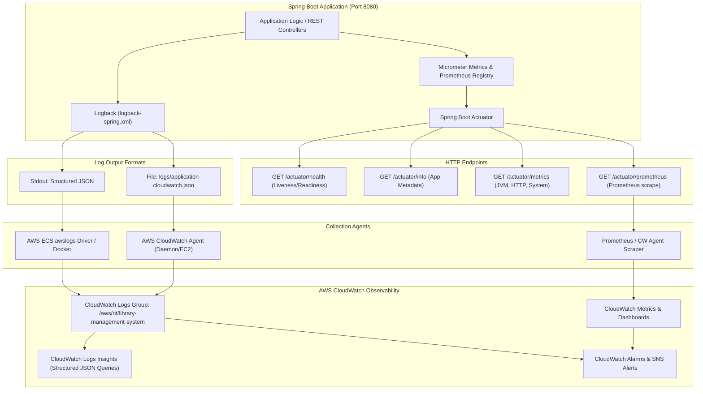

# Monitoring and Structured Logging Guide
## Library Management System — DevOps / SRE Operations Guide

---

## 1. Executive Summary & Architecture

This guide details the monitoring, observability, and structured logging architecture implemented for the **Library Management System** Spring Boot microservice. 

Modern cloud observability follows the **Three Pillars of Observability**:
- **Metrics:** Quantitative measurements over time (CPU, JVM memory, HTTP latency, error rates) exposed via **Spring Boot Actuator** and **Micrometer**.
- **Logs:** Discrete timestamped events formatted in structured **JSON** via **Logback** and ingested by **AWS CloudWatch Logs**.
- **Health Checks & Probes:** Real-time application lifecycle state exposed via `/actuator/health` (liveness and readiness probes) for AWS ECS, Kubernetes, and Application Load Balancers (ALB).

### Observability Architecture



---

## 2. Spring Boot Actuator Configuration

### 2.1 Dependencies (`pom.xml`)

We include `spring-boot-starter-actuator` and `micrometer-registry-prometheus`:

```xml
<!-- Spring Boot Actuator for health, info, and metrics endpoints -->
<dependency>
    <groupId>org.springframework.boot</groupId>
    <artifactId>spring-boot-starter-actuator</artifactId>
</dependency>

<!-- Micrometer Prometheus registry for metrics collection -->
<dependency>
    <groupId>io.micrometer</groupId>
    <artifactId>micrometer-registry-prometheus</artifactId>
</dependency>

<!-- Structured JSON Logging for Logback and AWS CloudWatch -->
<dependency>
    <groupId>net.logstash.logback</groupId>
    <artifactId>logstash-logback-encoder</artifactId>
    <version>7.4</version>
</dependency>
```

### 2.2 Actuator Properties (`src/main/resources/application.properties`)

```properties
# Expose health, info, metrics, and prometheus endpoints via /actuator
management.endpoints.web.exposure.include=health,info,metrics,prometheus
management.endpoints.web.base-path=/actuator

# Health Endpoint Configuration
management.endpoint.health.show-details=always
management.endpoint.health.show-components=always
management.endpoint.health.probes.enabled=true

# Info Endpoint Configuration
management.endpoint.info.enabled=true
management.info.env.enabled=true
management.info.java.enabled=true
management.info.os.enabled=true

# Application Metadata
info.app.name=Library Management System
info.app.description=Library Management System REST API (DevOps / SRE Monitoring Enabled)
info.app.version=0.0.1-SNAPSHOT
info.app.environment=${ENVIRONMENT:dev}

# Metrics & Prometheus Configuration
management.endpoint.metrics.enabled=true
management.endpoint.prometheus.enabled=true
management.metrics.export.prometheus.enabled=true

# Common Tags for Metrics
management.metrics.tags.application=${spring.application.name}
management.metrics.tags.environment=${ENVIRONMENT:dev}
```

### 2.3 Exposed Actuator Endpoints Summary

| Endpoint | HTTP Method | Description | Primary Consumer |
| :--- | :--- | :--- | :--- |
| `/actuator/health` | `GET` | Aggregated health status (`UP`, `DOWN`, `OUT_OF_SERVICE`) | Load Balancers, DevOps Health Dashboards |
| `/actuator/health/liveness` | `GET` | Verifies container is running and internal state is healthy | Kubernetes / AWS ECS Liveness Probe |
| `/actuator/health/readiness`| `GET` | Verifies app is ready to accept incoming traffic | Kubernetes / AWS ALB Target Group Health Check |
| `/actuator/info` | `GET` | Build version, environment, Java runtime info | SRE Deployment Tracking |
| `/actuator/metrics` | `GET` | Available meter names and real-time statistics | Internal debugging, CloudWatch Metrics |
| `/actuator/metrics/{name}`| `GET` | Detailed stats for a meter (e.g. `jvm.memory.used`, `http.server.requests`) | SRE diagnostic queries |
| `/actuator/prometheus` | `GET` | Metrics formatted for Prometheus and AWS CloudWatch Agent scraper | CloudWatch Agent / Prometheus Server |

---

## 3. Structured JSON Logging Architecture

### 3.1 Why Structured JSON for AWS CloudWatch?

Traditional plain-text logs (e.g. `2026-10-12 10:00:00 INFO [main] c.r.l.App: message`) pose significant challenges in cloud environments:
1. **Multi-line Stack Traces:** Plain-text logs treat stack traces as multiple separate log entries, breaking search context in CloudWatch.
2. **Parsing Overhead:** Requires expensive, fragile regex parsing rules (`grok` filters) in CloudWatch or Logstash.
3. **Loss of Metadata:** Contextual fields (such as `traceId`, `environment`, `userId`, `http_status`) cannot be indexed automatically.

With **Structured JSON Logging**:
- Each log line is a standalone, valid JSON object.
- AWS CloudWatch Logs Insights **automatically parses top-level JSON fields** without any custom regex or filter configuration.
- Stack traces are contained inside the `stack_trace` JSON attribute as a clean, single-event string.
- Filtering and aggregation by `level`, `application`, `logger`, or `traceId` are instant and sub-second.

### 3.2 Sample JSON Log Event

```json
{
  "timestamp": "2026-10-12T17:28:15.123Z",
  "level": "INFO",
  "thread": "http-nio-8080-exec-1",
  "logger": "com.rit.library.controller.AuthController",
  "message": "User authenticated successfully: testuser",
  "application": "library-management-system",
  "environment": "production",
  "log_source": "spring-boot",
  "traceId": "c4d29f10a8b7e21a",
  "spanId": "e5b882f0c78a10d9"
}
```

### 3.3 Logback Configuration Details (`logback-spring.xml`)

`src/main/resources/logback-spring.xml` configures:
- **`CONSOLE_JSON` (`ch.qos.logback.core.ConsoleAppender`):** Emits structured JSON directly to standard output (`System.out`), ideal for containerized environments (Docker, AWS ECS, AWS EKS).
- **`CLOUDWATCH_FILE` (`ch.qos.logback.core.rolling.RollingFileAppender`):** Writes JSON records to `logs/application-cloudwatch.json` with rolling policy (`50MB` per file, `14` days retention, gzip compression) for AWS CloudWatch Agent file monitoring.
- **`CONSOLE_TEXT` (`ch.qos.logback.core.ConsoleAppender`):** Available when the Spring profile is set to `local` for developer convenience.

---

## 4. How AWS CloudWatch & CloudWatch Agent Collect Logs

There are two primary collection mechanisms depending on the host infrastructure:

### Method A: Host / EC2 / On-Premises via AWS CloudWatch Agent

When running on an Amazon EC2 instance or virtual machine, the **AWS CloudWatch Agent (`amazon-cloudwatch-agent`)** is installed as a system daemon that monitors log files and streams them to CloudWatch.

#### 1. CloudWatch Agent Configuration File (`amazon-cloudwatch-agent.json`)

Create `/opt/aws/amazon-cloudwatch-agent/etc/amazon-cloudwatch-agent.json`:

```json
{
  "agent": {
    "metrics_collection_interval": 60,
    "run_as_user": "cwagent"
  },
  "logs": {
    "logs_collected": {
      "files": {
        "collect_list": [
          {
            "file_path": "/var/log/library-management-system/application-cloudwatch.json",
            "log_group_name": "/aws/rit/library-management-system",
            "log_stream_name": "{instance_id}-app-json",
            "timestamp_format": "%Y-%m-%dT%H:%M:%S.%fZ",
            "timezone": "UTC",
            "auto_removal": false
          }
        ]
      }
    }
  },
  "metrics": {
    "metrics_collected": {
      "mem": {
        "measurement": [
          "mem_used_percent"
        ]
      },
      "disk": {
        "measurement": [
          "used_percent"
        ],
        "resources": [
          "*"
        ]
      }
    }
  }
}
```

#### 2. Installing and Starting the Agent on EC2 (Amazon Linux / Ubuntu)

```bash
# 1. Download and install CloudWatch Agent
# Amazon Linux 2023:
sudo dnf install -y amazon-cloudwatch-agent

# Ubuntu:
wget https://amazoncloudwatch-agent.s3.amazonaws.com/ubuntu/amd64/latest/amazon-cloudwatch-agent.deb
sudo dpkg -i -E ./amazon-cloudwatch-agent.deb

# 2. Attach IAM Role to EC2:
# The EC2 instance must have an IAM role attached with the managed policy:
# CloudWatchAgentServerPolicy

# 3. Start CloudWatch Agent with the config
sudo /opt/aws/amazon-cloudwatch-agent/bin/amazon-cloudwatch-agent-ctl \
    -a fetch-config \
    -m ec2 \
    -s \
    -c file:/opt/aws/amazon-cloudwatch-agent/etc/amazon-cloudwatch-agent.json

# 4. Check agent status
sudo /opt/aws/amazon-cloudwatch-agent/bin/amazon-cloudwatch-agent-ctl \
    -a status
```

---

### Method B: Containerized Ingestion (AWS ECS / Fargate)

When running the application in **AWS ECS (Elastic Container Service)**:
The container writes structured JSON logs directly to `stdout`. The container runtime ships these logs using the **`awslogs` log driver**.

In your ECS Task Definition (`task-definition.json`):

```json
{
  "containerDefinitions": [
    {
      "name": "library-management-system",
      "image": "<aws_account_id>.dkr.ecr.<region>.amazonaws.com/library-management-system:latest",
      "portMappings": [
        {
          "containerPort": 8080,
          "hostPort": 8080
        }
      ],
      "environment": [
        {
          "name": "SPRING_PROFILES_ACTIVE",
          "value": "prod"
        },
        {
          "name": "ENVIRONMENT",
          "value": "production"
        }
      ],
      "logConfiguration": {
        "logDriver": "awslogs",
        "options": {
          "awslogs-group": "/aws/rit/library-management-system",
          "awslogs-region": "ap-south-1",
          "awslogs-stream-prefix": "ecs"
        }
      }
    }
  ]
}
```

---

### Method C: Kubernetes / AWS EKS via AWS CloudWatch Observability Add-on

In AWS EKS:
1. Deploy the **Amazon CloudWatch Observability EKS add-on** (or Fluent Bit daemonset).
2. The Fluent Bit daemon tails `/var/log/containers/*library-management-system*.log`.
3. Fluent Bit parses the JSON from the container standard output and streams it into the `/aws/containerinsights/<cluster-name>/application` CloudWatch Log Group.

---

## 5. CloudWatch Logs Insights Query Cheatsheet

Once logs are flowing into CloudWatch Logs in structured JSON, use **CloudWatch Logs Insights** to run fast queries:

### 1. View Most Recent Errors with Full Stack Traces
```sql
fields @timestamp, logger, message, stack_trace
| filter level = "ERROR"
| sort @timestamp desc
| limit 25
```

### 2. Error Frequency Breakdown by Logger
```sql
fields @timestamp, logger, message
| filter level = "ERROR"
| stats count(*) as error_count by logger
| sort error_count desc
```

### 3. Log Distribution by Level (INFO, WARN, ERROR, DEBUG)
```sql
stats count(*) as count by level
```

### 4. Search for User Login / Activity Events
```sql
fields @timestamp, message, application
| filter message like /(?i)login|auth/
| sort @timestamp desc
| limit 50
```

### 5. Slow Requests or Transaction Tracing (Using Trace ID)
```sql
fields @timestamp, level, message, traceId
| filter ispresent(traceId) and traceId = "c4d29f10a8b7e21a"
| sort @timestamp asc
```

---

## 6. CloudWatch Alarms & Metric Filters

DevOps engineers should configure the following automated alerts in AWS CloudWatch:

### Metric Filter: Application Error Rate Spike
1. Go to **CloudWatch > Log groups > `/aws/rit/library-management-system`**.
2. Click **Create metric filter**.
3. **Filter pattern:** `{ $.level = "ERROR" }`
4. **Metric namespace:** `RIT/LibrarySystem`
5. **Metric name:** `ApplicationErrorCount`
6. **Metric value:** `1`

### Alarm Definition:
- **Condition:** `ApplicationErrorCount >= 5` for 2 consecutive 1-minute evaluation periods.
- **Action:** Send alert to SNS Topic `arn:aws:sns:ap-south-1:123456789012:devops-alerts`.
- **Severity:** PagerDuty / High Priority.

### Synthetics / Health Alarm:
- **Target:** `GET https://<api-domain>/actuator/health`
- **Alarm:** Trigger when HTTP status != `200` or JSON response does not contain `"status": "UP"`.

---

## 7. Verification & Runbook Checklist

To verify that monitoring and structured logging are operational locally or in staging:

1. **Start the application:**
   ```bash
   mvn spring-boot:run
   ```
2. **Verify JSON Output in Console:**
   Observe stdout; verify that each line starts with `{` and ends with `}` containing `timestamp`, `level`, `logger`, `message`, and `application`.
3. **Verify File Logging:**
   Check that `logs/application-cloudwatch.json` is generated in the project root directory.
4. **Verify Health Endpoint:**
   ```bash
   curl -i http://localhost:8080/actuator/health
   # Expected: HTTP 200 OK, {"status":"UP",...}
   ```
5. **Verify Info Endpoint:**
   ```bash
   curl -i http://localhost:8080/actuator/info
   # Expected: HTTP 200 OK, {"app":{"name":"Library Management System",...}}
   ```
6. **Verify Metrics Endpoint:**
   ```bash
   curl -i http://localhost:8080/actuator/metrics
   curl -i http://localhost:8080/actuator/metrics/jvm.memory.used
   ```
7. **Verify Prometheus Scraping Endpoint:**
   ```bash
   curl -i http://localhost:8080/actuator/prometheus
   # Expected: OpenMetrics / Prometheus exposition format
   ```
